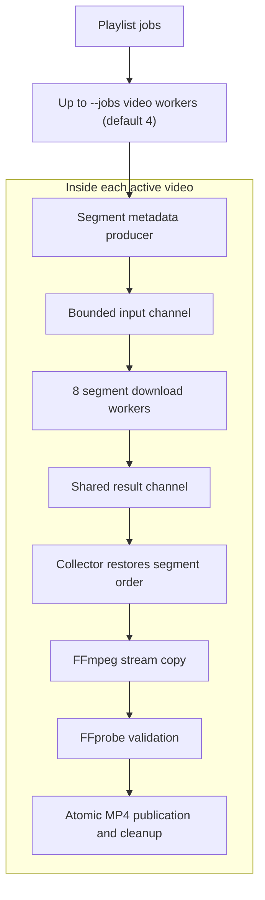

# DAI

**Fast Rutube downloads. Well-tested Go concurrency you can learn from.**

[](https://github.com/rolton1999/dai/actions/workflows/lint.yml)

DAI downloads Rutube videos and playlists to MP4, selecting the highest-resolution
supported HLS variant and using FFmpeg stream copy without re-encoding. It runs
up to **4 playlist videos at once**, with **8 concurrent segment downloads per
video**: up to **32 segment transfers** with the default settings.

Use it to save a playlist, or explore how worker pools, pipelines, fan-out,
fan-in, cancellation, and goroutine ownership fit together in a real CLI.

## Why DAI?

- **Fast by default.** Video and segment concurrency overlap network I/O, while
  stream copy avoids the cost of re-encoding. Set playlist concurrency with `--jobs`.
- **Restart with confidence.** `--resume` verifies completed MP4s by size and
  SHA-256 and downloads only missing or unfinished videos.
- **Protect your files.** Collision checks, FFprobe validation, and atomic
  publication keep incomplete conversions away from final destinations.
- **See what is happening.** Each active video has its own progress row and
  conversion spinner; a playlist summary tracks the overall download.
- **Read the design, test the behavior.** Race-enabled tests, local HTTP fixtures,
  failure injection, and real FFmpeg integration tests exercise the lifecycle.
  The [concurrency guide below](#learn-go-concurrency-from-the-implementation)
  connects classic Go references to the implementation and its tests.

## Quick start

Requires **Go 1.25 or later**, with **`ffmpeg` and `ffprobe` on `PATH`**.
Supported platforms: macOS, Linux, DragonFly BSD, FreeBSD, NetBSD, and OpenBSD.

```sh
git clone https://github.com/rolton1999/dai.git
cd dai
make build

# Download a video to the current directory.
./bin/dai https://rutube.ru/video/dace2feac379872d42e49b6b25c0587a/

# Download a playlist with four active videos and restart recovery enabled.
./bin/dai --resume --jobs 4 --output ./videos https://rutube.ru/plst/1840659/

./bin/dai --help
```

Run the same resume command again after interruption. Completed files are
verified and reused; unfinished videos restart from their first segment.

Flags must precede the URL:

| Flag | Description |
| --- | --- |
| `-h`, `--help` | Print usage and available flags, then exit successfully. |
| `--output <directory>` | Destination directory; defaults to the current directory. |
| `--jobs <count>` | Concurrent playlist videos; defaults to 4. Use 1 for sequential videos. |
| `--resume` | Record playlist progress and reuse verified completed MP4s on restart. |
| `--overwrite` | Allow replacing existing output files. |

DAI accepts HTTPS links on `rutube.ru` with `/video/<32 hex ID>` or
`/plst/<positive numeric ID>`. A trailing slash, query, or fragment is allowed.
`--jobs` controls videos; each active video still has eight segment workers.

## Does yt-dlp download Rutube in parallel?

**Yes, at the fragment level.** yt-dlp's [Rutube extractor][ytdlp-rutube] extracts
HLS formats, and its [native fragment downloader][ytdlp-fragments] supports
`-N` / `--concurrent-fragments`. The [documented default][ytdlp-options] is one
fragment at a time. For example, to enable eight concurrent fragments when
downloading a native HLS format:

```sh
yt-dlp --downloader "m3u8:native" -N 8 https://rutube.ru/plst/1840659/
```

That option controls fragments within a video. Reading yt-dlp's
[normal playlist loop][ytdlp-playlists] shows that it processes playlist videos
sequentially in one invocation. DAI also schedules multiple playlist videos:

| Concurrency | DAI | yt-dlp, normal single-process playlist flow |
| --- | --- | --- |
| Segments within a video | 8 workers per active video | Native HLS supports `-N`; default 1 |
| Videos within a playlist | `--jobs`, default 4 | Sequential playlist entries |

Source review: **2026-10-25**, yt-dlp commit
[`fa98866`](https://github.com/yt-dlp/yt-dlp/tree/fa9886678eb65103303c627b8e013f13f8999b41).
This describes the built-in flow; separate processes and external downloaders
can change the concurrency setup. The commands above have not been compared in
a live benchmark. DAI's speed comes from its concurrency defaults and stream-copy
design; actual throughput depends on the network, Rutube, disk, and workload.

## Learn Go concurrency from the implementation

DAI is also a practical example of canonical Go concurrency principles. Start
with Rob Pike's [Go Concurrency Patterns][go-patterns], then follow the mappings
below. Each row links the classic explanation to DAI's code and a behavior test.

| Pattern | Classic Go reference | DAI implementation | Tests to read |
| --- | --- | --- | --- |
| Bounded worker pool | [Bounded parallelism][go-pipelines] | [`downloadPlaylist`](internal/download/download.go#L211) schedules video jobs; [`processStageImpl.run`](internal/pipeline/process_stage.go#L36) runs eight segment workers. | [Worker limits, slot reuse, and cancellation](internal/download/playlist_test.go#L187) |
| Cooperative cancellation | [Go Concurrency Patterns: Context][go-context] | [`context.WithCancelCause` in playlist scheduling](internal/download/download.go#L211) and [pipeline execution](internal/pipeline/pipeline.go#L45) propagates failure; requests and processes receive contexts. | [Pipeline cancellation and worker joining](internal/pipeline/errors_test.go#L88) |
| Typed pipeline | [Pipelines and cancellation][go-pipelines] | [HLS stage assembly](internal/hls/download.go#L40) composes a producer, concurrent downloader, and collector through typed channels. | [Every item processed once](internal/pipeline/pipeline_test.go#L15) |
| Fan-out | [Fan-out, fan-in][go-pipelines] | [Segment workers](internal/pipeline/process_stage.go#L36) read a shared input channel, distributing work across a fixed pool. | [Cancellation across active workers](internal/pipeline/errors_test.go#L88) |
| Fan-in | [Fan-out, fan-in][go-pipelines] | [`fanIn`](internal/pipeline/pipeline.go#L98) merges producer channels; segment workers also send results into one shared output channel. | [Multiple producers and finalizers](internal/pipeline/errors_test.go#L242) |
| Backpressure | [Stopping short and cancellation][go-pipelines] | [Producer](internal/pipeline/produce_stage.go#L28) and [processor](internal/pipeline/process_stage.go#L36) queues are bounded; channel sends wait for capacity or cancellation. | [Downstream failure stops upstream work](internal/pipeline/errors_test.go#L146) |
| Join before cleanup | [`sync.WaitGroup`][go-waitgroup] and [Advanced Go Concurrency Patterns][go-advanced] | [Pipeline execution](internal/pipeline/pipeline.go#L45) joins workers before returning; [download ownership](internal/hls/download.go#L40) keeps temporary files alive until writers stop. | [Partial writer joined before directory removal](internal/hls/lifecycle_test.go#L218) |
| Ordered results from concurrent work | [Pipelines and cancellation][go-pipelines] | [`newConsumeStage`](internal/hls/download.go#L127) records each completed segment at its original index. | [Reverse completion preserves segment order](internal/hls/lifecycle_test.go#L53) |
| Ticker-driven spinner | [`time.NewTicker`][go-ticker] and [`sync.Once`][go-once] | [`SpinningMessageContext`](internal/progress/spinner.go#L16) waits on ticks, cancellation, or a stop channel; its idempotent stop function joins the goroutine. | [Cancellation and concurrent stop calls](internal/progress/spinner_test.go#L37) |
| Cancellable retry delay | [Context][go-context] and [`time.NewTimer`][go-timer] | [Metadata retries](internal/retry/retry.go#L8) and [segment retries](internal/hls/segment_download.go#L25) wait on a timer or cancellation. | [Retry cancellation](internal/retry/retry_test.go#L64) and [segment retry policy](internal/hls/segment_download_test.go#L207) |

Here, interrupting a worker means **cooperative cancellation** at context checks,
channel operations, HTTP requests, and subprocess boundaries. The spinner is
timer-driven animation: it waits between frames rather than busy-waiting.

### Design example: two levels of concurrency

After metadata and destination preflight, video workers claim playlist jobs.
Each active video builds its own segment pipeline:



A video worker claims the next job as soon as conversion, validation,
publication, and cleanup finish. Slow videos occupy their own slots while other
workers continue. See [`downloadPlaylist`](internal/download/download.go#L211) and
[its slot-reuse test](internal/download/playlist_test.go#L187).

### Design example: compose the stages

This excerpt from [`downloadTSFiles`](internal/hls/download.go#L40) wires the segment
pipeline. All stages carry `segmentMeta`, so incompatible stage types fail at
compile time.

```go
produceStage := newProduceStage(segmentMetas)
loadStage := newLoadStage(httpClient)
consumeStage, listOfFiles := newConsumeStage(logger, len(segmentMetas))

downloadPipeline := pipeline.NewPipeline[segmentMeta]()
downloadPipeline.AppendProducer(produceStage)
downloadPipeline.AppendMedium(loadStage)
downloadPipeline.AppendFinalizer(consumeStage)

if err := downloadPipeline.Run(operationContext); err != nil {
    return nil, err
}
```

Workers can finish segments out of order. The collector fills `listOfFiles` by
segment index, so FFmpeg receives the original playback order. `Run` propagates
the first failure, cancels sibling work, and joins every worker before returning.
The pipeline supports multiple producer channels through `fanIn`; the HLS path
currently uses one producer, with the multi-producer case covered by tests.

### Design example: own the spinner lifecycle

The converter starts the spinner explicitly and always stops and joins it:

```go
stop := progress.SpinningMessageContext(operationContext, logger, conversionMessage, "")
defer stop()
```

Read [the caller](internal/ffmpeg/concat.go#L204), [the ticker/select loop and stop
function](internal/progress/spinner.go#L16), and [the concurrent-stop test](internal/progress/spinner_test.go#L37)
together. The same ownership principle applies to download workers: cancel,
join, then remove operation-owned temporary files. Contexts are passed explicitly
instead of being stored in structs.

## Output, recovery, and supported streams

Each MP4 is validated with FFprobe before atomic publication. Failed segments or
FFmpeg input/conversion errors fail the operation. Ctrl-C or the first failure
stops further scheduling and cancels active work; workers finish cleanup before
exit. Completed playlist videos remain available if another video fails.

Existing destinations require `--overwrite`. Duplicate playlist filenames are
rejected before downloading, even with overwrite enabled, using the destination
filesystem's case and Unicode normalization rules. Titles become filenames:
separators and control characters are replaced with underscores, surrounding
dots and spaces are trimmed, and leading hyphens receive an underscore prefix.
Names are limited to 200 UTF-8 bytes before `.mp4`; empty names become `video.mp4`.

Use `--resume` from the first playlist run. DAI keeps a versioned
`.dai-playlist-<ID>.json` manifest and a `.lock` file in the output directory.
Completed MP4s are verified by size and SHA-256. Missing or unfinished videos
restart from the beginning; fragments are never reused. Recorded filenames stay
stable if titles change. Changed, untracked, or symlink outputs cause an error
and are preserved; move conflicting files aside to continue. Resume is
playlist-only and cannot combine with `--overwrite`. The lock prevents concurrent
resume runs for the same playlist and releases on process exit. Keep the manifest
with the downloaded files; completed runs retain it for future reuse.

Interactive terminals show independent progress rows and conversion spinners.
Small terminals prioritize active videos and recent completions. Redirected
output uses completion lines in playlist order.

DAI supports complete, unencrypted MPEG-TS HLS playlists in segment order.
Resolution determines variant selection; bandwidth breaks ties. Relative URLs
resolve after redirects. Separate media tracks, encryption, byte ranges,
initialization maps, and live or partial playlists are rejected.

## Testing and development

The test suite covers parsing, retries, cancellation, worker limits, immediate
slot reuse, shutdown, output collisions, concurrent publication, progress rows,
and playlist recovery. Both HLS parsers have fuzz targets. Dependencies are
injected so failure paths can run against local HTTP fixtures and process doubles.

```sh
make build
make lint              # Pinned linter; applies fixes, including integration sources
make test              # Race-enabled tests; no live Rutube or FFmpeg required
make test-integration  # Local HTTP fixtures and real FFmpeg/FFprobe
```

| Layer | What it verifies | Entry points |
| --- | --- | --- |
| Unit and concurrency tests | Cancellation, ordering, bounded work, cleanup, retry policies, output preservation, manifest validation, checksums, stable filenames, checkpoint failures, and lock release after process termination | [`internal/pipeline`](internal/pipeline), [`internal/hls`](internal/hls), [`internal/download`](internal/download), [`internal/progress`](internal/progress) |
| Local integration tests | Redirects, real segment conversion, MP4 validation, unusual filenames, corrupt middle/final segments, failure reporting, and reuse of completed MP4s | [Download](internal/download/local_integration_test.go), [recovery](internal/download/resume_integration_test.go), [FFmpeg](internal/ffmpeg/concat_integration_test.go) |
| Live checksum smoke tests | Known video and playlist outputs, sequential/parallel downloads, and restart recovery against Rutube | [E2E requirements and checksums](tests/e2e/README.md) |

[CI](.github/workflows/lint.yml) runs lint and race-enabled unit tests. Integration
tests run locally on demand. Concurrency tests wait for observable conditions
with deadlines. Retry tests use fake time and injected waits to avoid wall-clock
backoff delays.

Live tests are opt-in: `make e2e-single`, `make e2e-playlist` (one video worker),
`make e2e-playlist-parallel` (four workers), and `make e2e-playlist-resume`
(restart recovery with four workers). `make test-small` and `make test-big` alias
the single-video and sequential-playlist tests. `make test-all` runs every suite,
including live tests, and stops on failure.

Local fixtures do not establish live Rutube compatibility. Live checksum tests
have not been rerun against the current implementation, and no comparative
throughput benchmark is published here.

[ytdlp-rutube]: https://github.com/yt-dlp/yt-dlp/blob/fa9886678eb65103303c627b8e013f13f8999b41/yt_dlp/extractor/rutube.py
[ytdlp-fragments]: https://github.com/yt-dlp/yt-dlp/blob/fa9886678eb65103303c627b8e013f13f8999b41/yt_dlp/downloader/fragment.py#L442-L451
[ytdlp-options]: https://github.com/yt-dlp/yt-dlp/blob/fa9886678eb65103303c627b8e013f13f8999b41/README.md#download-options
[ytdlp-playlists]: https://github.com/yt-dlp/yt-dlp/blob/fa9886678eb65103303c627b8e013f13f8999b41/yt_dlp/YoutubeDL.py#L1987-L2013
[go-patterns]: https://go.dev/talks/2012/concurrency.slide
[go-pipelines]: https://go.dev/blog/pipelines
[go-context]: https://go.dev/blog/context
[go-advanced]: https://go.dev/blog/io2013-talk-concurrency
[go-waitgroup]: https://pkg.go.dev/sync#WaitGroup
[go-once]: https://pkg.go.dev/sync#Once
[go-ticker]: https://pkg.go.dev/time#NewTicker
[go-timer]: https://pkg.go.dev/time#NewTimer
