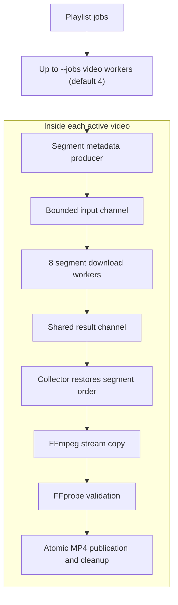

# Learn Go concurrency from the implementation

[Back to the README](../README.md)

DAI is also a practical example of canonical Go concurrency principles. Start
with Rob Pike's [Go Concurrency Patterns][go-patterns], then follow the mappings
below. Each row links the classic explanation to DAI's code and a behavior test.

| Pattern                              | Classic Go reference                                                                 | DAI implementation                                                                                                                                                                                                    | Tests to read                                                                                                                       |
| ------------------------------------ | ------------------------------------------------------------------------------------ | --------------------------------------------------------------------------------------------------------------------------------------------------------------------------------------------------------------------- | ----------------------------------------------------------------------------------------------------------------------------------- |
| Bounded worker pool                  | [Bounded parallelism][go-pipelines]                                                  | [`downloadPlaylist`](../internal/download/download.go#L211) schedules video jobs; [`processStageImpl.run`](../internal/pipeline/process_stage.go#L36) runs eight segment workers.                                     | [Worker limits, slot reuse, and cancellation](../internal/download/playlist_test.go#L187)                                           |
| Cooperative cancellation             | [Go Concurrency Patterns: Context][go-context]                                       | [`context.WithCancelCause` in playlist scheduling](../internal/download/download.go#L211) and [pipeline execution](../internal/pipeline/pipeline.go#L45) propagates failure; requests and processes receive contexts. | [Pipeline cancellation and worker joining](../internal/pipeline/errors_test.go#L88)                                                 |
| Typed pipeline                       | [Pipelines and cancellation][go-pipelines]                                           | [HLS stage assembly](../internal/hls/download.go#L40) composes a producer, concurrent downloader, and collector through typed channels.                                                                               | [Every item processed once](../internal/pipeline/pipeline_test.go#L15)                                                              |
| Fan-out                              | [Fan-out, fan-in][go-pipelines]                                                      | [Segment workers](../internal/pipeline/process_stage.go#L36) read a shared input channel, distributing work across a fixed pool.                                                                                      | [Cancellation across active workers](../internal/pipeline/errors_test.go#L88)                                                       |
| Fan-in                               | [Fan-out, fan-in][go-pipelines]                                                      | [`fanIn`](../internal/pipeline/pipeline.go#L98) merges producer channels; segment workers also send results into one shared output channel.                                                                           | [Multiple producers and finalizers](../internal/pipeline/errors_test.go#L242)                                                       |
| Backpressure                         | [Stopping short and cancellation][go-pipelines]                                      | [Producer](../internal/pipeline/produce_stage.go#L28) and [processor](../internal/pipeline/process_stage.go#L36) queues are bounded; channel sends wait for capacity or cancellation.                                 | [Downstream failure stops upstream work](../internal/pipeline/errors_test.go#L146)                                                  |
| Join before cleanup                  | [`sync.WaitGroup`][go-waitgroup] and [Advanced Go Concurrency Patterns][go-advanced] | [Pipeline execution](../internal/pipeline/pipeline.go#L45) joins workers before returning; [download ownership](../internal/hls/download.go#L40) keeps temporary files alive until writers stop.                      | [Partial writer joined before directory removal](../internal/hls/lifecycle_test.go#L218)                                            |
| Ordered results from concurrent work | [Pipelines and cancellation][go-pipelines]                                           | [`newConsumeStage`](../internal/hls/download.go#L127) records each completed segment at its original index.                                                                                                           | [Reverse completion preserves segment order](../internal/hls/lifecycle_test.go#L53)                                                 |
| Ticker-driven spinner                | [`time.NewTicker`][go-ticker] and [`sync.Once`][go-once]                             | [`SpinningMessageContext`](../internal/progress/spinner.go#L16) waits on ticks, cancellation, or a stop channel; its idempotent stop function joins the goroutine.                                                    | [Cancellation and concurrent stop calls](../internal/progress/spinner_test.go#L37)                                                  |
| Cancellable retry delay              | [Context][go-context] and [`time.NewTimer`][go-timer]                                | [Metadata retries](../internal/retry/retry.go#L8) and [segment retries](../internal/hls/segment_download.go#L25) wait on a timer or cancellation.                                                                     | [Retry cancellation](../internal/retry/retry_test.go#L64) and [segment retry policy](../internal/hls/segment_download_test.go#L207) |

Here, interrupting a worker means **cooperative cancellation** at context checks,
channel operations, HTTP requests, and subprocess boundaries. The spinner is
timer-driven animation: it waits between frames rather than busy-waiting.

## Design example: two levels of concurrency

After metadata and destination preflight, video workers claim playlist jobs.
Each active video builds its own segment pipeline:



A video worker claims the next job as soon as conversion, validation,
publication, and cleanup finish. Slow videos occupy their own slots while other
workers continue. See [`downloadPlaylist`](../internal/download/download.go#L211) and
[its slot-reuse test](../internal/download/playlist_test.go#L187).

## Design example: compose the stages

This excerpt from [`downloadTSFiles`](../internal/hls/download.go#L40) wires the segment
pipeline. All stages carry `segmentMeta`, so incompatible stage types fail at
compile time.

```go
produceStage := newProduceStage(segmentMetas)
loadStage := newLoadStage(httpClient)
consumeStage, listOfFiles := newConsumeStage(logger, len(segmentMetas))

downloadPipeline := pipeline.NewPipeline[segmentMeta]()
downloadPipeline.AppendProducer(produceStage)
downloadPipeline.AppendMedium(loadStage)
downloadPipeline.AppendFinalizer(consumeStage)

if err := downloadPipeline.Run(operationContext); err != nil {
    return nil, err
}
```

Workers can finish segments out of order. The collector fills `listOfFiles` by
segment index, so FFmpeg receives the original playback order. `Run` propagates
the first failure, cancels sibling work, and joins every worker before returning.
The pipeline supports multiple producer channels through `fanIn`; the HLS path
currently uses one producer, with the multi-producer case covered by tests.

## Design example: own the spinner lifecycle

The converter starts the spinner explicitly and always stops and joins it:

```go
stop := progress.SpinningMessageContext(operationContext, logger, conversionMessage, "")
defer stop()
```

Read [the caller](../internal/ffmpeg/concat.go#L204), [the ticker/select loop and stop
function](../internal/progress/spinner.go#L16), and [the concurrent-stop test](../internal/progress/spinner_test.go#L37)
together. The same ownership principle applies to download workers: cancel,
join, then remove operation-owned temporary files. Contexts are passed explicitly
instead of being stored in structs.

[go-patterns]: https://go.dev/talks/2012/concurrency.slide
[go-pipelines]: https://go.dev/blog/pipelines
[go-context]: https://go.dev/blog/context
[go-advanced]: https://go.dev/blog/io2013-talk-concurrency
[go-waitgroup]: https://pkg.go.dev/sync#WaitGroup
[go-once]: https://pkg.go.dev/sync#Once
[go-ticker]: https://pkg.go.dev/time#NewTicker
[go-timer]: https://pkg.go.dev/time#NewTimer
